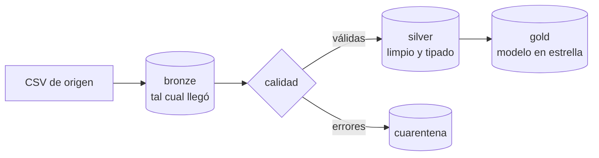

# 🌌 Insight_Horizon

**De datos en bruto a datos fiables.** Un pipeline ETL completo con arquitectura *medallion*, pruebas automáticas e integración continua, más una colección de notebooks de análisis.

[](https://github.com/SalmeronDevZone/Insight_Horizon/actions/workflows/pipeline.yml)


## Qué hay aquí

| Carpeta | Contenido |
| --- | --- |
| [`pipeline/`](pipeline/) | **Pipeline ETL de ventas**: CSV sucios → bronze → silver → modelo en estrella en SQLite. Idempotente, incremental, con cuarentena de filas erróneas y 13 pruebas |
| [`pipeline/retos/`](pipeline/retos/) | **8 retos** para llevarlo a producción: contratos de datos, SCD tipo 2, particionado, borrados en origen, orquestación... |
| [`notebooks/`](notebooks/) | Análisis con pandas, scikit-learn y SciPy: correlación, optimización, k-NN y Montecarlo |

## El pipeline en 30 segundos

```bash
git clone https://github.com/SalmeronDevZone/Insight_Horizon.git
cd Insight_Horizon/pipeline
python -m etl.pipeline      # carga los datos de ejemplo
python -m unittest -v       # 13 pruebas
```



Los datos de ejemplo traen los errores de siempre: fechas en dos formatos, decimales con coma, duplicados, clientes que no existen, cantidades negativas y una venta que se corrige un mes después. El pipeline los resuelve todos. El detalle está en el [README del pipeline](pipeline/README.md).

## Lo que demuestra este proyecto

- **Modelado dimensional:** tabla de hechos, dimensiones y una dimensión de fechas generada.
- **Calidad de datos:** reglas declarativas, cuarentena con motivos e informe de calidad en JSON.
- **Cargas robustas:** idempotencia por checksum, incrementales, *upserts* para correcciones tardías y una transacción por fichero.
- **Ingeniería de software aplicada a datos:** código modular, pruebas automáticas y CI con GitHub Actions, que publica el informe de calidad como artefacto.

## Tecnologías

Python 3 (sólo la librería estándar: `csv`, `sqlite3`, `decimal`, `hashlib`, `logging`, `unittest`), SQL (SQLite), GitHub Actions. Los notebooks usan pandas, NumPy, scikit-learn, SciPy, GEKKO, Matplotlib y seaborn.

---

**Jesús Salmerón** · Data Engineer · [GitHub](https://github.com/SalmeronDevZone) · [LinkedIn](https://www.linkedin.com/in/jesussalmeronarmario/)
