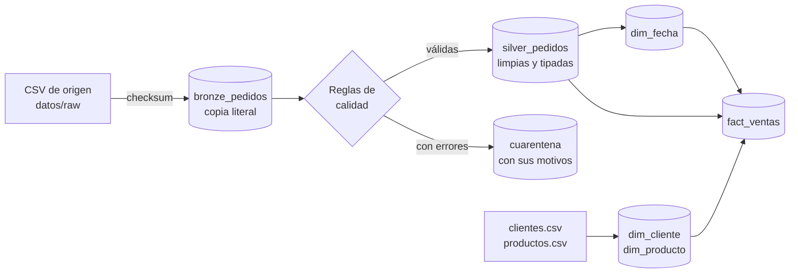

# Pipeline ETL de ventas

Convierte los CSV que exportan los sistemas de origen, con sus errores, en un **modelo en estrella fiable** sobre SQLite, siguiendo la arquitectura *medallion* (bronze → silver → gold). Sólo usa la librería estándar de Python: no hay nada que instalar.



## Ejecutarlo

```bash
cd pipeline
python -m etl.pipeline          # datos/raw -> salida/ventas.db + salida/informe_calidad.json
python -m unittest -v           # 13 pruebas
```

Con los datos de ejemplo verás esto:

| Métrica | Valor | Por qué |
| --- | --- | --- |
| Filas leídas | 38 | 21 de enero + 17 de febrero |
| A cuarentena | 7 | Cantidad negativa o vacía, cliente o producto inexistente, fecha `2025-13-01`, precio `abc`, canal `fax` |
| Duplicados descartados | 2 | `V0005` y `V0030` vienen repetidas |
| Ventas en gold | 28 | 29 válidas, pero `V0003` llega dos veces: la de febrero corrige la de enero |
| Importe total | 5.110,12 € | |

Si lo ejecutas otra vez, no carga nada: los dos ficheros ya estaban cargados y su checksum no ha cambiado.

## Qué problemas reales resuelve

| Problema del mundo real | Cómo lo resuelve |
| --- | --- |
| El origen manda datos sucios | Normaliza fechas (`2025-01-15` y `15/01/2025`), decimales con coma (`24,50`), canales (`WEB ` → `web`), ciudades y emails |
| Una fila mala no debe parar la carga | La fila va a `cuarentena` con **todos** sus motivos, no sólo el primero, y el resto sigue |
| Relanzar un proceso no debe duplicar datos | Cargas **idempotentes**: cada fichero se identifica por su SHA-256 en `control_ficheros` |
| Llegan datos nuevos cada día | Carga **incremental**: sólo se procesan los ficheros nuevos o modificados |
| El origen corrige una venta días después | *Upsert* por `id_venta` en silver (correcciones tardías) |
| Un fallo a mitad de un fichero | Una transacción por fichero: o se carga entero o no se carga |
| Auditoría: «¿qué nos mandaron exactamente?» | Bronze guarda cada fila tal cual llegó, en JSON |
| Analítica rápida y sencilla | Gold en estrella: `fact_ventas` + `dim_cliente`, `dim_producto`, `dim_fecha` |

## Estructura

```
pipeline/
├── etl/
│   ├── config.py       Rutas y valores de referencia
│   ├── extraer.py      Lectura de CSV y checksum
│   ├── calidad.py      Normalización y reglas de calidad
│   ├── cargar.py       Esquema SQLite y carga por capas
│   └── pipeline.py     Orquestación y línea de comandos
├── datos/raw/          Datos de ejemplo, con errores a propósito
├── tests/              Pruebas con unittest
└── retos/              Ejercicios para ampliar el pipeline, y sus soluciones
```

## Retos

¿Quieres practicar? En [`retos/`](retos/) hay 8 ejercicios para llevarlo al nivel de producción: contratos de datos, SCD tipo 2, particionado, borrados en origen, métricas de calidad y orquestación con GitHub Actions.
